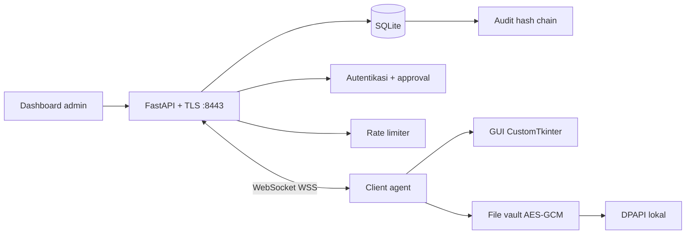

# remote-admin-lab

[](https://www.python.org/)
[](https://fastapi.tiangolo.com/)
[](#arsitektur)
[](#file-protection)
[](#database-dan-audit)
[](#pengujian)

Remote administration dua arah untuk Windows 10/11 64-bit. Server pusat memakai FastAPI, WebSocket/TLS, SQLite, dan dashboard admin. Client agent dijalankan secara sadar oleh pemilik perangkat dan menyimpan identitas serta kunci di perangkat itu sendiri.

> Tidak ada remote shell arbitrer, persistence tersembunyi, credential harvesting, atau kunci enkripsi yang dikirim lewat jaringan. Setiap aksi sensitif memerlukan approval admin **dan** konfirmasi lokal pengguna client.

---

## Daftar isi

- [Arsitektur](#arsitektur)
- [Komponen](#komponen)
- [Persyaratan](#persyaratan)
- [Quickstart](#quickstart)
- [Kredensial first-run](#kredensial-first-run)
- [Menjalankan server](#menjalankan-server)
- [Menjalankan client](#menjalankan-client)
- [Alur operasi](#alur-operasi)
- [Database dan audit](#database-dan-audit)
- [Keamanan](#keamanan)
- [Pengujian](#pengujian)
- [Packaging EXE](#packaging-exe)
- [Relay produksi](#relay-produksi)
- [Struktur folder](#struktur-folder)
- [Dokumen lanjutan](#dokumen-lanjutan)
- [Catatan repo](#catatan-repo)

---

## Arsitektur



Prinsip alur:

1. Server tidak pernah mengirim perintah shell bebas; hanya task dari daftar allowlist.
2. Task dibuat sebagai `pending`, lalu disetujui atau ditolak dari dashboard.
3. Client menjalankan task yang disetujui dan mengembalikan `task_result`.
4. Kunci AES untuk file vault dibungkus DPAPI dan tidak pernah dikirim ke server.
5. Protect, approve, unlock, dan recovery tercatat di `audit_logs` berbasis hash chain.

---

## Komponen

| Folder | Isi |
|---|---|
| `server/` | API, autentikasi, rate limit, approval, WebSocket manager, database, GUI admin |
| `client/` | Koneksi, identity DPAPI, system info, file vault, recovery, GUI |
| `shared/` | Model Pydantic, definisi protokol, helper AES-GCM + DPAPI |
| `tests/` | Pengujian protokol, kripto, database, API, dan client vault |
| `tools/` | Generator sertifikat dev, smoke test TLS, builder EXE |
| `client-release/` | Paket client mandiri: `config/`, `certs/`, `exe/`, `src/`, `data/` |

Peta file utama:

| File | Peran |
|---|---|
| `server/main.py` | Entry point server, mode GUI dan headless |
| `server/api.py` | Endpoint HTTP dan admin |
| `server/websocket_manager.py` | Manajemen koneksi client dan pengiriman task |
| `server/approvals.py` | State machine approval |
| `server/rate_limit.py` | Pembatasan login, endpoint admin, handshake WS |
| `server/database.py` | Skema SQLite dan trigger audit append-only |
| `client/main.py` | Entry point GUI client |
| `client/connection.py` | Koneksi WSS dan sertifikat CA |
| `client/file_protection.py` | Enkripsi salinan file |
| `client/recovery.py` | Dekripsi dan verifikasi hasil pulihkan |
| `shared/crypto_utils.py` | AES-GCM, DPAPI, hash, dan validasi |

---

## Persyaratan

| Item | Nilai | Catatan |
|---|---|---|
| Python | 3.12+ | Dikembangkan dan diuji pada 3.14 |
| OS | Windows 10/11 64-bit | DPAPI terikat ke akun Windows |
| Server | Lokal atau VPS | VPS dipakai untuk mode relay produksi |
| TLS | Self-signed atau CA publik | Sertifikat dev dibuat otomatis bila belum ada |
| Port | TCP `8443` | Buka di firewall bila client berada di mesin lain |

---

## Quickstart

```powershell
cd remote-admin-lab
python -m venv .venv
.\.venv\Scripts\python -m pip install -r requirements.txt
.\.venv\Scripts\python -m pytest -q

# Server dengan dashboard
.\.venv\Scripts\python -m server.main

# Client, di jendela PowerShell terpisah
.\.venv\Scripts\python -m client.main
```

Cek server hidup:

```powershell
curl.exe -k https://127.0.0.1:8443/health
```

Status sukses: HTTP `200`.

---

## Kredensial first-run

Saat server pertama kali dijalankan, nilai berikut dicetak **satu kali** di console:

| Item | Nilai |
|---|---|
| Username admin | `admin` |
| Password admin | `<ADMIN_PASSWORD>` |
| Enrollment code client | `<ENROLLMENT_CODE>` |

Password dan enrollment code tidak disimpan plaintext. Yang tersimpan di `server/config/settings.json`:

| Field | Bentuk |
|---|---|
| Password admin | salt + hash PBKDF2-SHA256, 210.000 iterasi |
| Enrollment code | hash SHA-256 |
| Token perangkat | hash, bukan token mentah |

Nilai baru dicetak ulang hanya bila file config dihapus atau field hash-nya dikosongkan.

---

## Menjalankan server

### Mode GUI

```powershell
.\.venv\Scripts\python -m server.main
```

Dashboard muncul di komputer server. Login dengan `admin`, password dari console first-run, dan CA certificate `server/certs/server.crt`.

### Mode headless

```powershell
.\.venv\Scripts\python -m server.main --no-gui --host 0.0.0.0 --port 8443
```

Gunakan `--host 0.0.0.0` bila client berada di komputer lain. Untuk lab satu komputer, default `127.0.0.1` sudah cukup.

### Firewall LAN

```powershell
New-NetFirewallRule -DisplayName "Remote Admin Lab 8443" -Direction Inbound -Protocol TCP -LocalPort 8443 -Action Allow
```

Jalankan PowerShell sebagai Administrator di server.

---

## Menjalankan client

Dari source:

```powershell
.\.venv\Scripts\python -m client.main
```

Dari paket EXE:

```powershell
.\client-release\exe\remote-admin-client.exe
```

Pada frame **Koneksi**:

1. Isi `Server URL`, misalnya `wss://relay.example.com:8443/ws/client`.
2. Isi `CA certificate` dengan file sertifikat CA/server yang dipercaya.
3. Isi `Enrollment code` dari console first-run server.
4. Tekan **Simpan Pengaturan**, lalu **Connect**.
5. Tunggu status menjadi online / terhubung ke server.

Identity client (`device_id`, token, enrollment code) disimpan di `client/config/identity.blob`, terlindungi DPAPI untuk akun Windows yang bersangkutan. Koneksi berikutnya memakai token tersebut; enrollment code tidak perlu diisi ulang.

> Jangan salin `identity.blob` atau isi folder `data/` ke komputer lain. Keduanya terikat ke akun Windows dan perangkat tempat client pertama kali dijalankan.

---

## Alur operasi

### Task administratif

Daftar task yang diizinkan:

| Task | Keterangan |
|---|---|
| `system_info` | Informasi sistem |
| `cpu_ram` | Utilisasi CPU dan memori |
| `disk` | Informasi disk |
| `network` | Informasi jaringan |
| `agent_status` | Status agent |
| `transfer_file` | Kirim salinan terenkripsi, maks 25 MB |

Urutan:

1. Admin memilih client online dan task dari allowlist.
2. Task dibuat dengan status `pending`.
3. Admin menekan **Approve** atau **Reject**.
4. Task yang disetujui dikirim melalui WebSocket.
5. Client menjalankan collector dan mengembalikan `task_result`.

### File protection

1. Pengguna memilih file atau folder secara manual di tab **File Protection**.
2. Client membuat salinan terenkripsi AES-256-GCM dengan kunci acak 32 byte.
3. Salinan divalidasi dengan dekripsi uji dan hash SHA-256 sebelum status menjadi `protected`.
4. Kunci dibungkus DPAPI dan tetap di perangkat client.
5. File asli tidak dihapus atau ditimpa.

### Unlock dan recovery

1. Client membuat `unlock_request` berisi request ID, client ID, file, waktu, alasan, dan status.
2. Admin melihat metadata file lalu menyetujui atau menolak.
3. Persetujuan server dikirim ke client, tetapi tidak membuka file.
4. Pengguna menekan **Konfirmasi & Pulihkan** dan memilih lokasi tujuan.
5. Client membuka kunci DPAPI lokal, mendekripsi salinan, memverifikasi tag GCM serta hash, lalu menulis hasil pemulihan.
6. Hasil dicatat di audit log lokal dan server.

Bila server offline, **Recover Offline** tetap tersedia selama akun Windows dapat membuka DPAPI. Event recovery offline disinkronkan setelah koneksi kembali.

---

## Database dan audit

File: `server/data/server.sqlite3`.

| Tabel | Isi |
|---|---|
| `clients` | Identitas perangkat dan status |
| `sessions` | Sesi koneksi client |
| `tasks` | Task administratif dan hasilnya |
| `file_records` | Metadata salinan terenkripsi |
| `unlock_requests` | Permintaan buka kunci |
| `approvals` | Keputusan admin |
| `audit_logs` | Jejak event append-only dengan hash chain |

`audit_logs` memiliki trigger yang menolak `UPDATE` dan `DELETE`. Dashboard menampilkan status hash chain `valid` atau `RUSAK`. Setiap protect, approve, unlock, dan recovery harusnya muncul di sana.

---

## Keamanan

| Mekanisme | Implementasi |
|---|---|
| Transport | TLS/WSS dengan verifikasi sertifikat dan hostname |
| Identitas | Token unik per perangkat, diverifikasi sebagai hash |
| Enrollment | Code sekali pakai saat pendaftaran awal, diverifikasi sebagai hash |
| Password admin | PBKDF2-SHA256, 210.000 iterasi |
| Rate limit | Login, endpoint admin, handshake WebSocket |
| Validasi pesan | Model Pydantic dengan `extra="forbid"` |
| Kunci enkripsi | AES-GCM dibungkus DPAPI, tidak dikirim ke server |
| Audit | Append-only + hash chain |
| Eksekusi | Hanya allowlisted task, bukan shell arbitrer |

---

## Pengujian

```powershell
.\.venv\Scripts\python -m pytest -q
.\.venv\Scripts\python -m tools.e2e_check --enrollment-code <ENROLLMENT_CODE>
```

Smoke test sukses bila muncul:

```text
e2e-ok status=('online', 'terhubung ke server') messages=['hello_ack']
```

---

## Packaging EXE

Mode one-dir dipilih agar sertifikat, database, dan konfigurasi dapat dikelola di luar binary.

```powershell
# Server + client + paket client mandiri
.\.venv\Scripts\python -m tools.build_exe all

# Hanya paket client mandiri
.\.venv\Scripts\python -m tools.build_exe client-release
```

Hasil:

| Path | Isi |
|---|---|
| `dist/remote-admin-server/` | Server one-dir |
| `dist/remote-admin-client/` | Client one-dir |
| `client-release/` | Paket client mandiri untuk komputer lain |

<details>
<summary>Struktur <code>client-release/</code></summary>

```text
client-release/
├── config/settings.json
├── certs/server.crt
├── exe/remote-admin-client.exe
├── exe/_internal/
├── src/client/
├── src/shared/
├── src/requirements-client.txt
├── src/run-client.bat
├── data/
├── diagnose.ps1
├── diagnose.bat
└── README.md
```

</details>

Sebelum dipakai di komputer lain, ubah `server_url` di `client-release/config/settings.json`:

```json
{
  "server_url": "wss://<ip-atau-domain-server>:8443/ws/client",
  "ca_cert": "certs\\server.crt"
}
```

Jalankan dari source di paket client:

```powershell
cd .\client-release\src
pip install -r requirements-client.txt
.\run-client.bat
```

Petunjuk lengkap untuk komputer client ada di [`client-release/README.md`](client-release/README.md).

---

## Relay produksi

1. Arahkan DNS `relay.example.com` ke VPS.
2. Terbitkan sertifikat Let’s Encrypt untuk domain tersebut.
3. Isi konfigurasi server:

   | Field | Nilai |
   |---|---|
   | `cert_file` | `/etc/letsencrypt/live/relay.example.com/fullchain.pem` |
   | `key_file` | `/etc/letsencrypt/live/relay.example.com/privkey.pem` |
   | `server_name` | `relay.example.com` |

4. Buka hanya port yang diperlukan di firewall.
5. Distribusikan CA publik atau chain Let’s Encrypt ke client; client tetap memverifikasi hostname dan sertifikat.

Untuk lab lokal, sertifikat self-signed mencakup `localhost` dan `127.0.0.1` pada SAN. Bila alamat server berubah, regenerate sertifikat dengan SAN alamat tersebut dan salin ulang `server.crt` ke client.

---

## Struktur folder

```text
remote-admin-lab/
├── README.md
├── TUTORIAL.md
├── requirements.txt
├── .gitignore
├── server/
│   ├── main.py
│   ├── api.py
│   ├── authentication.py
│   ├── approvals.py
│   ├── rate_limit.py
│   ├── websocket_manager.py
│   ├── database.py
│   ├── config.py
│   ├── config/settings.json
│   ├── certs/server.crt
│   ├── data/server.sqlite3
│   └── gui/dashboard.py
├── client/
│   ├── main.py
│   ├── connection.py
│   ├── authentication.py
│   ├── config.py
│   ├── system_info.py
│   ├── file_protection.py
│   ├── recovery.py
│   └── gui/app.py
├── shared/
│   ├── protocol.py
│   ├── models.py
│   └── crypto_utils.py
├── tests/
├── tools/
├── client-release/
├── dist/
└── build/
```

---

## Dokumen lanjutan

| Dokumen | Isi |
|---|---|
| [`TUTORIAL.md`](TUTORIAL.md) | Panduan operasional server, client, approval, recovery, dan troubleshoot |
| [`client-release/README.md`](client-release/README.md) | Petunjuk singkat untuk komputer client |
| [`requirements.txt`](requirements.txt) | Dependensi Python server dan client |

---

## Catatan repo

Berkas berikut sengaja tidak ikut dipublikasikan:

| Berkas | Alasan |
|---|---|
| `SESSION_SUMMARY.md` | Catatan sesi lokal berisi IP dan kredensial lama |
| `server/certs/*.key` | Private key sertifikat development |
| `server/config/settings.json` | Hash dan konfigurasi lokal |
| `server/data/`, `client/data/`, `client-release/data/` | Database dan artefak runtime |
| `client/config/`, `client-release/config/identity.blob` | Identity terikat ke perangkat |
| `dist/`, `build/`, `client-release/exe/` | Artefak build |

Kredensial contoh di dokumentasi diganti placeholder; nilai aslinya dicetak sekali oleh server saat first-run.
